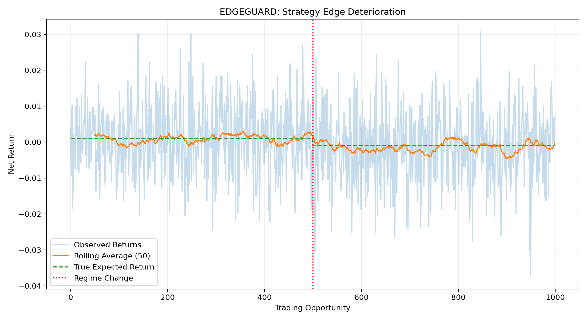

# EDGEGUARD

**Sequential Statistical Monitoring for Quantitative Trading Strategies**

*A reproducible Python research project investigating the detection of deteriorating trading strategy profitability.*

## Overview

Quantitative trading strategies may experience changes in their expected profitability as market conditions evolve. Distinguishing genuine deterioration from random fluctuations is a statistical challenge.

EDGEGUARD investigates whether sequential statistical monitoring methods can detect deterioration while balancing false alarms, detection delays, and missed changes.

The project currently compares rolling-mean monitoring with downward cumulative-sum (CUSUM) detection using controlled synthetic return sequences.

**Project status:** Synthetic simulation and initial detector benchmarking completed. Robustness testing and historical-market validation are planned.

## Research Question

Can sequential change-detection methods identify deterioration in a trading strategy's expected net return while controlling false alarms and minimizing detection delay?

## Mathematical Framework

We simulate strategy returns using:

\[
R_t = \mu_t + \sigma Z_t
\]

where:

- \(R_t\) is the simulated strategy return.
- \(\mu_t\) is the true expected return.
- \(\sigma\) is return volatility.
- \(Z_t\) is independent standard normal noise.

The expected return changes according to:

\[
\mu_t =
\begin{cases}
0.001, & t < 500 \\
-0.001, & t \geq 500
\end{cases}
\]

The simulation contains 1,000 observations with a standard deviation of 0.01.

These are simplified synthetic assumptions rather than a realistic model of live trading profitability.

## Detection Methods

### 1. Rolling-Mean Detector

The rolling mean is calculated as:

\[
\bar R_t = \frac{1}{w}\sum_{i=t-w+1}^{t}R_i
\]

The detector signals when the rolling mean falls below a specified threshold.

Experiments compare window sizes and alarm thresholds to evaluate the trade-off between false alarms and detection delay.

### 2. CUSUM Detector

The downward CUSUM statistic is:

\[
S_t = \max(0, S_{t-1}+\mu_0-R_t-\delta)
\]

An alarm is triggered when \(S_t > h\).

CUSUM accumulates evidence of sustained deterioration rather than relying only on a fixed rolling window.

Both methods are established statistical techniques.

## Experimental Methodology

The experiments use seeded synthetic return sequences for reproducibility.

Alarm thresholds are calibrated on no-change simulations, then evaluated on independent no-change and regime-change simulations.

The primary evaluation metrics are:

- Probability of at least one false alarm during a fixed monitoring horizon.
- Premature-alarm proportion before a known change point.
- Successful-detection proportion.
- Missed-detection proportion.
- Average detection delay conditional on successful detection.

The current benchmarks use 1,000 calibration simulations and 500 independent evaluation simulations.

## Experimental Results

### Initial Rolling-Mean Evaluation

With a 50-observation window and a zero alarm threshold, the detector triggered prematurely in 498 of 500 regime-change simulations.

Increasing the window size reduced premature alarms but also changed the detector's responsiveness.

### Threshold Calibration

The rolling-mean detector was calibrated to target approximately 5% false alarms across a 1,000-observation no-change horizon.

CUSUM was independently calibrated using the same nominal target.

### Calibrated Detector Comparison

| Metric | Rolling Mean | CUSUM |
|---|---:|---:|
| No-change false alarms | 6.6% | 6.8% |
| Premature alarms | 3.8% | 2.8% |
| Successful detections | 59.6% | 93.8% |
| Missed detections | 36.6% | 3.4% |
| Average delay among successful detections | 213.17 | 195.42 |

CUSUM achieved a 34.2-percentage-point higher successful-detection proportion in the tested synthetic scenario.

The conditional delay averages are calculated on different subsets of simulations and should not be interpreted as a direct estimate of unconditional detection speed.

These results do not establish superiority across different market conditions or real trading data.

## Experiment 01 Visualization



## Repository Structure

```text
EDGEGUARD/
├── src/
│   └── edgeguard/
│       ├── __init__.py
│       ├── simulator.py
│       └── detectors.py
├── tests/
│   ├── test_simulator.py
│   └── test_detectors.py
├── experiments/
│   ├── experiment_01.py
│   ├── experiment_02.py
│   ├── experiment_03.py
│   ├── experiment_04.py
│   ├── experiment_05.py
│   ├── experiment_06.py
│   └── experiment_07.py
├── results/
│   └── experiment_01.png
├── requirements.txt
└── README.md
```

## Installation and Reproduction

Requires Python and the dependencies listed in `requirements.txt`.

Create a virtual environment:

```bash
python3 -m venv .venv
source .venv/bin/activate
python -m pip install -r requirements.txt
```

Run the complete test suite:

```bash
PYTHONPATH=src python -m pytest -v
```

Run the calibrated detector experiments:

```bash
PYTHONPATH=src python experiments/experiment_06.py
PYTHONPATH=src python experiments/experiment_07.py
```

The project currently contains 15 passing automated tests.

## Limitations

- Simulated returns are independent and Gaussian.
- The volatility and pre-change expected return are specified by the simulation.
- Only a limited set of market-change scenarios has been evaluated.
- The calibrated thresholds target a fixed monitoring horizon.
- The results do not yet include uncertainty intervals for detector comparisons.
- No real historical market data or realistic execution model has been evaluated.
- The experiments do not demonstrate actual trading profitability.

## Planned Research

1. Evaluate robustness across volatility levels, edge magnitudes, and gradual deterioration.
2. Introduce autocorrelated and heavy-tailed returns.
3. Quantify uncertainty in benchmark comparisons.
4. Develop adaptive risk-control decisions.
5. Evaluate on historical data using chronological out-of-sample testing.
6. Investigate transaction costs, slippage, and execution assumptions.

## Research Integrity

EDGEGUARD is an educational and experimental quantitative research project. Its current findings apply only to the specified synthetic scenarios and should not be interpreted as live trading recommendations or evidence of real-world profitability.